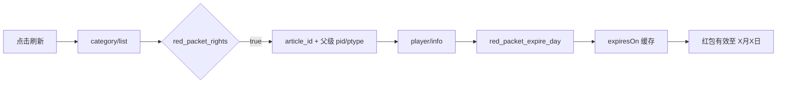

# 知识红包到期日接入报告

> 分析日期：2026-09-19  
> 报告类型：普通 Android 逆向与互操作（flavor = null）  
> 工具链：ADB、JADX 1.5.5、Gradle、Android 真机

## 执行摘要

可以在每篇知识红包后显示准确的过期日期，并且已经完成实现与真机验证。红包列表接口只返回领取时间和当前权益状态，不能直接给出截止日期；得到的播放器元数据接口会返回 `red_packet_expire_day`。新版伴侣会在刷新时并发补齐该字段，再显示为“红包有效至 9月22日”。本次真机同步的 23 条有效红包全部取得了非空日期，且没有打开文章详情、启动播放或导出登录凭据与完整响应。

## 范围与授权

- Scope：[scope.md](../../work/dedao-redpacket-expiry/scope.md)
- 目标：用户自有已连接 Android 设备、得到 13.3.0、知识红包伴侣 0.4.1-rc1
- 网络范围：仅用户设备上的两个官方 App 及其既有会话调用
- 边界：不读取 cookie/token，不导出音频，不绕过红包权益

## 关键结论

1. `mustard-view/v1/red_packet/category/list` 的 `authority_intro.red_packet_rights` 仍是“当前是否有效”的权威判据。
2. 列表中的 `collection_timestamp` 是领取时间，`free_end_time` 对已观察条目为 0，不能当作红包截止时间。
3. `bauhinia/v1/class/player/info` 接收 `article_id + pid + ptype`，并返回可直接显示的 `data.red_packet_expire_day`。
4. 新缓存保存 `expiresOn`；旧缓存或单条补齐失败时保持原文案，不从时间差猜日期。

## 调用路径



## Evidence

| ID | 证据 | source_ref | repro_command | content_hash |
|----|------|------------|---------------|--------------|
| E-001 | APK 内字段模型和接口调用 | 官方 APK + JADX 输出 | 见 `work/dedao-redpacket-expiry/evidence/E-001.md` | `ae868abd…55845` |
| E-002 | 原生 WebView 会话返回 `9月22日` | 受限动态字段探测 | 见 `work/dedao-redpacket-expiry/evidence/E-002.md` | n/a |
| E-003 | 23/23 有效条目保存日期 | 已连接真机 | 见 `work/dedao-redpacket-expiry/evidence/E-003.md` | n/a |

完整证据目录：[evidence](../../work/dedao-redpacket-expiry/evidence/)。

## Findings

| ID | 结论 | 等级 | 状态 | evidence_ids | 置信度 | 位置 |
|----|------|------|------|--------------|--------|------|
| F-001 | 官方播放器元数据可准确返回红包到期日 | info | validated | E-001,E-002 | high | `player/info / red_packet_expire_day` |
| F-002 | 伴侣的同步、缓存和界面已接入该日期 | info | validated | E-002,E-003 | high | `DedaoBridgeServer` → `RedPacketItem` → `MainActivity` |

结构化 Findings 与 Path：[findings.md](../../work/dedao-redpacket-expiry/report/findings.md)。

## Path

P-001（`path_type=callflow`）：刷新 → 有效权益过滤 → 提取课程与文章标识 → 查询播放器元数据 → 白名单化截止日期 → 缓存 → 列表显示。每个步骤均由 E-001 至 E-003 支撑。

## 实现与兼容性

- 最多 6 个并发 worker 补齐日期，单条失败不会让整次同步失败。
- 查询期间每 8 秒向本地 nonce bridge 发送保活事件，避免大量条目导致回调服务器超时。
- `expiresOn` 是向后兼容字段；旧缓存读取为空字符串。
- 已学完条目显示“已学完 · X月X日过期”，未学完条目显示“红包有效至 X月X日”。
- 有效期和播放提示采用左右分栏，“点击播放/当前播放”右对齐并与日期保持 12dp 间距。
- 系统通知关闭不会再被当成首页待处理事项；播放监控和后台受限等真正影响连续播放的状态仍会提示。

## 验证结果

```bash
JAVA_HOME=/opt/homebrew/opt/openjdk@17/libexec/openjdk.jdk/Contents/Home \
  ./gradlew testDebugUnitTest assembleDebug lintDebug
node scripts/test-bridge-page.mjs
```

- Gradle：成功（36 个单元测试通过，assembleDebug 与 lintDebug 通过）。
- Bridge 页面回归：成功，覆盖列表请求、有效期请求、回跳成功/失败与原生回跳兜底。
- 真机：versionCode 15 / 0.4.1-rc1；23 条有效红包中 23 条有日期。
- 真机权限状态：播放监控已授权、后台未受限、通知权限关闭；新版首页不再显示可选通知提示。
- APK SHA-256：`37824eb9e3d09ffa3dd20bd433f585e1f6495f64fd15b9edee70922014cceca7`。

## 遗留风险

得到未来可能调整 endpoint、参数或字段名。当前实现对单条元数据失败做安全降级，仍保留权益有效性判断与旧文案；如官方契约变化，应重新采样而不是推算固定有效天数。

## Timeline 摘要

- 22:58：完成授权范围和设备识别。
- 23:14：静态定位 `red_packet_expire_day` 与 `player/info`。
- 23:17：动态验证返回准确日期。
- 23:25：实现、构建、回归与 23/23 真机验证完成。

完整时间线：[timeline.md](../../work/dedao-redpacket-expiry/timeline.md)。
